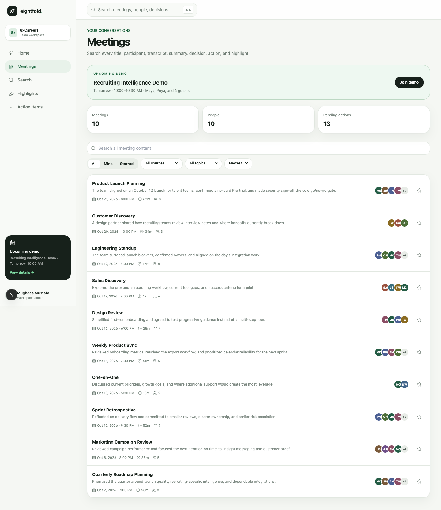
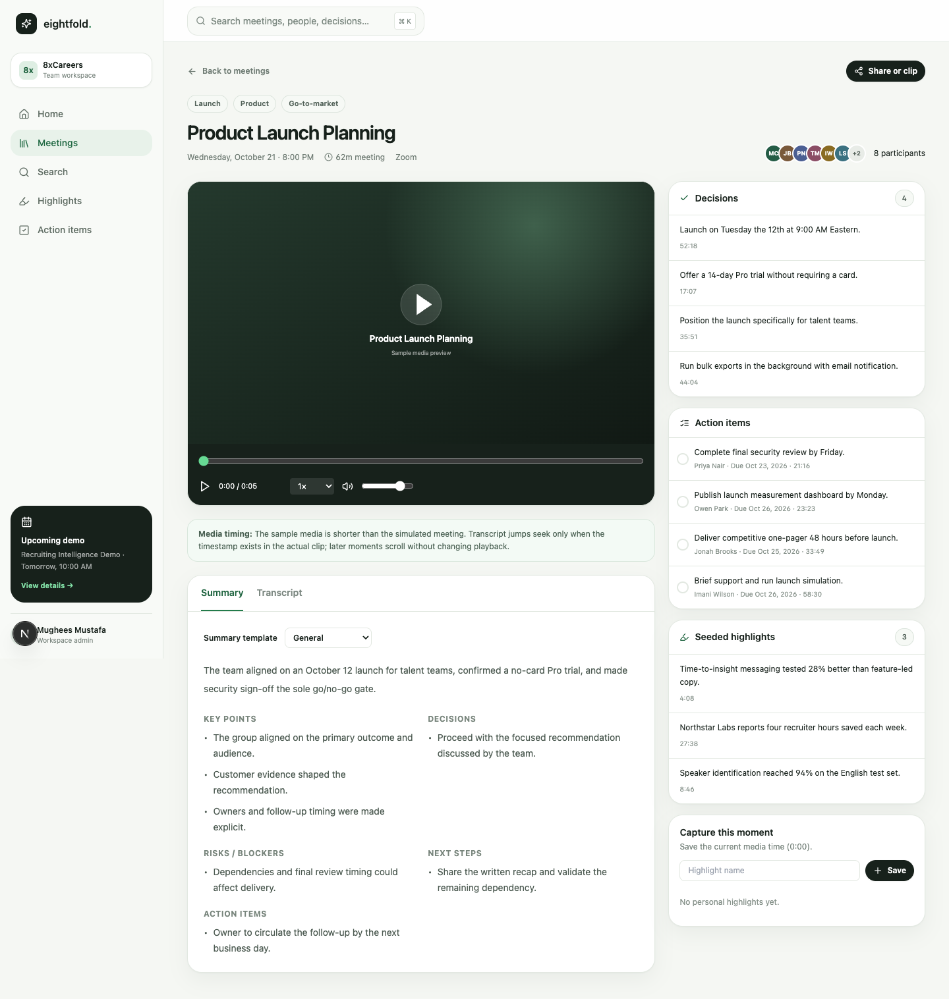
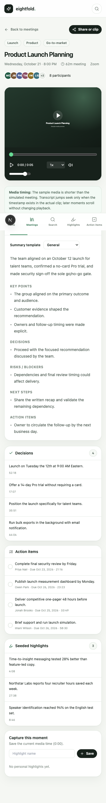

# 8xCareers Meeting Intelligence

A polished, Fathom-inspired meeting intelligence product built for exploring, understanding, and acting on workplace conversations. The application turns fictional meeting data into searchable transcripts, structured summaries, decisions, highlights, and persistent action workflows.

## Feature matrix

| Area | Capabilities |
| --- | --- |
| Dashboard | Product entry points and recent meetings |
| Meetings | Full-text search, source/topic filters, personal/starred scopes, four sort modes, persisted stars, and responsive list views |
| Meeting detail | Native media player, speed/volume/seek controls, searchable transcript, timestamp navigation, auto-scroll, template-based summaries, decisions, highlights, and due-dated actions |
| Actions | Pending/completed views, owners, due dates, and local persistence shared with meeting detail |
| Highlights | Seeded insights plus create, navigate to, and delete personal highlights |
| Search | Cross-entity search over meetings, participants, transcripts, decisions, actions, and highlights |
| Sharing | Public meeting routes, bounded clip URLs, transcript context, and explicit demo-media disclosure |
| Responsive UI | Desktop sidebar and mobile bottom navigation with keyboard-visible focus states and semantic labels |

## Architecture

The project uses Next.js 15 App Router, React 19, TypeScript, and Tailwind CSS. Routes under `app/` compose reusable client components; `lib/meetings.ts` is the typed seeded domain layer; and `lib/storage.ts` isolates browser persistence. Meeting detail routes are statically generated. Public shares resolve from stable meeting IDs and URL parameters, so no backend is required for the assignment demo.

State that represents user interaction—stars, completed actions, and personal highlights—is stored in `localStorage`. Seeded meeting intelligence stays server-readable and deterministic. Playwright runs the product through its public UI at desktop and mobile breakpoints.

## Setup

Requirements: Node.js 20+ and pnpm.

```bash
pnpm install
pnpm dev
```

Open [http://localhost:3000](http://localhost:3000). The repository already declares all required dependencies; no services or environment variables are needed.

## Testing

```bash
pnpm lint
pnpm typecheck
pnpm test:e2e
pnpm build
```

The Playwright suite covers navigation, meeting discovery, search/filter/sort, detail/player semantics, transcript behavior, summary templates, action persistence, highlight lifecycle, sharing, clip context, and responsive navigation. Tests deliberately assert player state and controls rather than treating browser autoplay as proof of playback.

## Deployment

The app can be deployed as a standard Next.js project on Vercel or another Node-compatible host:

1. Import the repository.
2. Use the detected `pnpm build` command.
3. Deploy without environment variables.

No `vercel.json` is necessary because the framework defaults cover the application.

## Screenshots

### Meetings library



### Meeting intelligence workspace



### Mobile meeting view



## Demo data and media

All meetings, people, summaries, transcripts, decisions, action items, and highlights are fictional. “Product Launch Planning” represents a simulated 62-minute conversation. The native player uses MDN’s public CC0 `flower.mp4` asset as a short playback sample; it is not a recording of the simulated meeting. Both private and public views disclose that transcript timestamps may be outside the sample media, and transcript navigation never remaps those timestamps.

## Limitations and tradeoffs

- Persistence is browser-local, not synchronized across devices or users.
- Sharing URLs model product behavior but are not access-controlled or backed by stored share records.
- Media availability depends on the remote MDN sample; transcript and summary workflows remain useful if it fails.
- The data layer is intentionally seeded and read-only; recording, ingestion, transcription, authentication, and collaboration infrastructure are outside assignment scope.
- Long transcripts are rendered in a bounded scrolling region but are not yet virtualized.

See [docs/product-decisions.md](docs/product-decisions.md) for prioritization and future-work rationale.
